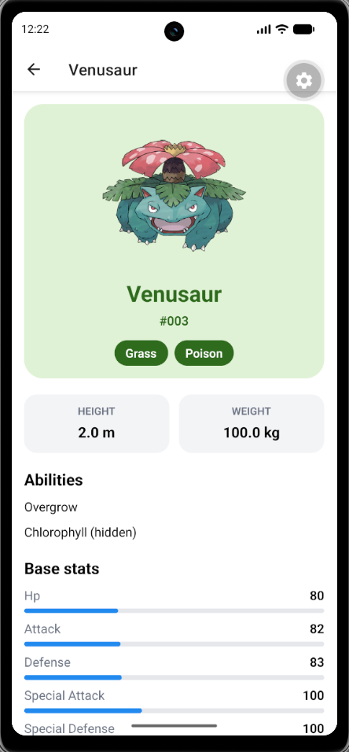
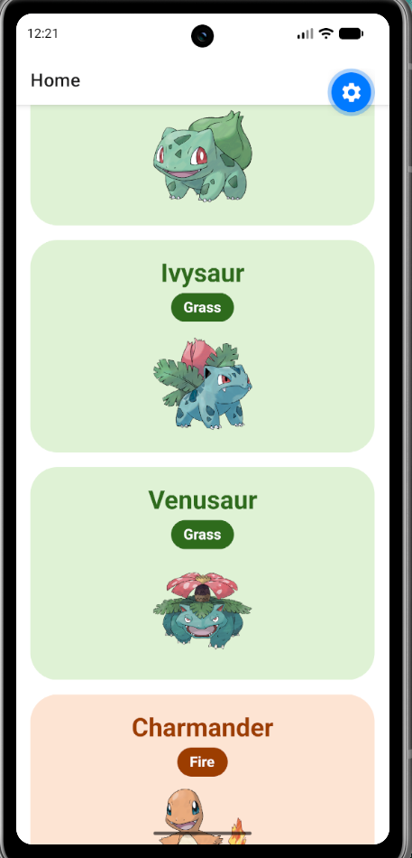

<h1 align="center">Pokédex</h1>

<p align="center">
  A Pokédex for iOS, Android, and the web, built with <a href="https://expo.dev">Expo</a> and React Native.
  It shows Pokémon cards colored by type, with a detail screen for stats and abilities.
</p>

<p align="center">
  <a href="https://expo.dev"></a>
  <a href="https://reactnative.dev"></a>
  <a href="https://www.typescriptlang.org"></a>
  <a href="https://tailwindcss.com"></a>
  <a href="https://tanstack.com/query"></a>
  <a href="https://bun.sh"></a>
</p>

<p align="center">
  
  
</p>

---

## About

Pokédex fetches 20 Pokémon from [PokéAPI](https://pokeapi.co) and renders them as scrolling cards. Each card takes its background, label, and type chip colors from a shared type palette, so Grass Pokémon render green, Fire render orange, and so on. Tapping a card opens a detail screen with the official artwork, dex number, types, height, weight, abilities, and base stats.

There is **no backend**. The app calls the public PokéAPI directly, and that API needs no key. TanStack Query caches responses on the client for five minutes.

## Features

- **Type-themed surfaces.** Cards and the detail hero pull colors from `src/constants/pokemon-types.ts`.
- **Official artwork.** `expo-image` renders official artwork and falls back to `sprites.front_default`.
- **Skeleton loading.** The list shows `SkeletonCard`, a placeholder with the same size and shape as a real card.
- **Pull to refresh.** `RefreshControl` calls TanStack Query's `refetch`.
- **Retry on failure.** A failed request shows the error message and a Try again button.
- **Cached data.** List and detail queries share keys, so returning to a screen renders from cache.

## Tech stack

| Area | Choice |
| --- | --- |
| Runtime | Expo SDK 58, React Native 0.88, React 19 |
| Router | Expo Router, file-based |
| Styling | Tailwind CSS v4 via Uniwind |
| Class merging | `cn` (clsx + tailwind-merge) |
| Data | TanStack Query v5, axios |
| API | PokéAPI, public and keyless |
| Language | TypeScript 6, strict mode |
| Lint | ESLint with `eslint-config-expo` |
| Package manager | Bun |

## Getting started

### Prerequisites

- [Bun](https://bun.sh) 1.4 or newer, since the repository ships a `bun.lock`.
- Expo Go on a device, or Xcode / Android Studio for local simulators.

### Install and run

```bash
bun install
bun run start
```

Then press `i` for iOS, `a` for Android, or `w` for web.

### Scripts

| Script | Description |
| --- | --- |
| `bun run start` | Start the Expo dev server |
| `bun run ios` | Start and open the iOS simulator |
| `bun run android` | Start and open the Android emulator |
| `bun run web` | Start the web build |
| `bun run lint` | Lint with ESLint |
| `bunx tsc --noEmit` | Typecheck only, no files written |

> [!IMPORTANT]
> There is no test runner and no CI. Before committing, run `bun run lint` and `bunx tsc --noEmit`.

## Project structure

```text
.
├── metro.config.js           # Wraps Metro with Uniwind, points at src/global.css
├── eslint.config.js          # eslint-config-expo, ignores .expo/ and dist/
├── tsconfig.json             # @/* maps to ./src/*
├── assets/                   # Screenshots used in this README
└── src
    ├── app/                  # Expo Router routes
    │   ├── _layout.tsx       # Stack navigator, QueryClientProvider, CSS import
    │   ├── index.tsx         # Home list
    │   └── details.tsx       # Detail screen
    ├── api/
    │   └── pokemon.ts        # axios client, PokeAPI types, fetchers
    ├── components/
    │   ├── shimmer.tsx       # Skeleton card shown while loading
    │   ├── error-state.tsx   # Error message with retry button
    │   ├── centered-message.tsx
    │   └── uni-image.ts      # expo-image wrapper that accepts className
    ├── constants/
    │   └── pokemon-types.ts  # Type-to-color palette
    ├── hooks/
    │   └── use-pokemon.ts    # Query hooks and keys
    ├── lib/
    │   ├── query-client.ts   # Shared QueryClient settings
    │   └── format-name.ts    # "special-attack" to "Special Attack"
    ├── global.css            # Tailwind and Uniwind entry
    └── uniwind-types.d.ts    # Generated class name types
```

## Architecture

### Routing and screens

- `src/app/_layout.tsx` imports `src/global.css`, wraps the app in `QueryClientProvider`, and declares a `Stack` with `index` and `details` screens.
- Every file under `src/app/` becomes a route, so adding `src/app/favorites.tsx` creates `/favorites`. Set its title in `_layout.tsx` when you want a header label.
- `details.tsx` reads `name` with `useLocalSearchParams`, so `/details?name=pikachu` opens that Pokémon.

To add a screen:

1. Create the file under `src/app/`.
2. Add a `Stack.Screen` entry in `src/app/_layout.tsx` for a custom title.
3. Navigate to it with `router.push` from `expo-router`.

### Data fetching

- `src/api/pokemon.ts` creates a single axios instance with `https://pokeapi.co/api/v2` as the base URL and a 15 second timeout.
- A response interceptor turns a 404 into `Error("Pokémon not found")`.
- `fetchPokemonCards` loads `/pokemon?limit=20`, then fetches those 20 records in parallel with `Promise.all` to read each primary type and artwork.
- `src/hooks/use-pokemon.ts` wraps both fetchers in `useQuery`. The detail query stays disabled until a name exists.
- `src/lib/query-client.ts` sets `staleTime` to five minutes and `retry` to 2.

### Path alias

`@/*` maps to `./src/*` in `tsconfig.json`, so imports look like `@/api/pokemon`.

## Styling and theming

Tailwind v4 is configured in CSS, not JavaScript. `src/global.css` contains `@import "tailwindcss"` and `@import "uniwind"`, and `metro.config.js` points Uniwind at that file.

- `src/constants/pokemon-types.ts` stores complete class strings such as `bg-[#DFF2D5]` and `text-[#2F6B1F]`. Keep new theme entries in that shape.
- `cn` from the `cn` package merges base classes with theme classes where a component needs conditionals.
- `expo-image` does not accept `className` on its own, so `src/components/uni-image.ts` wraps it with `withUniwind`.
- `src/uniwind-types.d.ts` is generated. Regenerate it after changing the CSS entry or themes:

```bash
bunx uniwind generate-artifacts --css ./src/global.css --dts ./src/uniwind-types.d.ts
```

> [!WARNING]
> Tailwind only emits a class when the full string appears in source. Do not build class names with interpolation such as `bg-[${color}]`. Map to complete strings, the way the type palette does.

## Data and content

All content comes from PokéAPI at runtime. To change what the app shows:

- Change `/pokemon?limit=20` in `src/api/pokemon.ts` to load a different number of Pokémon.
- Extend `src/api/pokemon.ts` when you need more response fields. The exported `PokemonDetails` type mirrors the subset the app reads.
- Artwork resolves from official artwork, then `sprites.front_default`, then an empty image slot.
- `src/lib/format-name.ts` turns `special-attack` into `Special Attack` for display.

## Build and ship

The repository has no `ios/` or `android/` folders. Expo generates them at build time, so do not create or edit them by hand.

```bash
bunx eas-cli build --platform ios
bunx eas-cli build --platform android
```

> [!NOTE]
> `eas.json` is not checked in yet. The first `eas build` walks through setup and creates it.

## Conventions

- **Conventional Commits** for messages, for example `feat(app): add skeleton loading state`.
- **ESLint** with `eslint-config-expo`, run with `bun run lint`. `.expo/` and `dist/` are ignored.
- **TypeScript strict** is enabled. Use `import type` for type-only imports.
- **Expo-managed packages.** Install new dependencies with `bunx expo install <package>` so versions match SDK 58.
- **No hand-written native code.** Configure native behavior through Expo config instead of editing generated `ios/` or `android/` folders.
